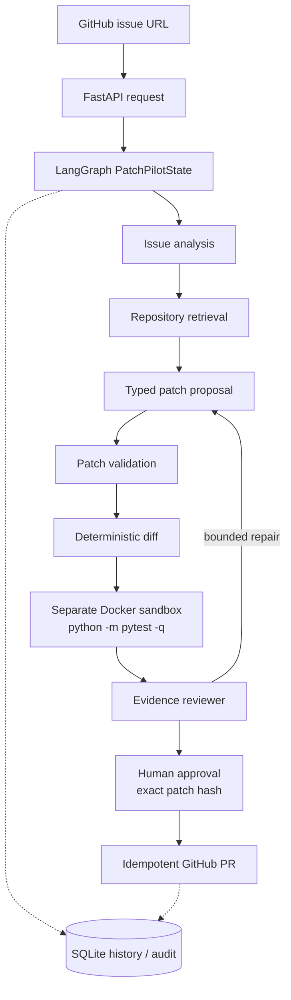

# PatchPilot

**A bounded, reviewable AI software-repair workflow for Python repositories.**

PatchPilot turns a GitHub issue into a typed, validated, sandbox-tested,
human-approved pull request. The core design idea is simple:

> The model **proposes**. Deterministic code **validates, tests, persists, and publishes**.


> **Status: Python-only MVP.** PatchPilot does not claim cross-language support,
> production-grade security, high throughput, or verified live pull-request
> creation. See [Limitations](#limitations).

---

## Table of contents

- [What it does](#what-it-does)
- [Workflow](#workflow)
- [Architecture](#architecture)
- [Design principles](#design-principles)
- [Technology choices](#technology-choices)
- [MVP scope](#mvp-scope)
- [Security boundary](#security-boundary)
- [Getting started](#getting-started)
- [Frontend console](#frontend-console)
- [API reference](#api-reference)
- [Sandbox image](#sandbox-image)
- [Containerized API](#containerized-api)
- [Testing and evaluation](#testing-and-evaluation)
- [Demo](#demo)
- [Limitations](#limitations)
- [Roadmap](#roadmap)
- [Further documentation](#further-documentation)

---

## What it does

PatchPilot accepts an HTTPS GitHub issue URL and runs a controlled,
auditable pipeline:

1. Fetch the issue and repository metadata.
2. Convert the issue into a structured problem analysis.
3. Retrieve a bounded set of relevant Python files, with provenance and hashes.
4. Ask the model for a canonical, typed patch proposal.
5. Validate paths, operations, original content, protected files, and patch size.
6. Generate a deterministic diff from trusted local content.
7. Apply the proposal **only** inside a disposable Docker workspace.
8. Run `python -m pytest -q` with no network access.
9. Ask a reviewer model to judge only the bounded evidence.
10. Wait for explicit human approval using the exact patch hash.
11. Create a workflow branch, commit the validated files, and open a PR.

## Workflow



Plain-text version:

```text
GitHub issue URL
        |
        v
FastAPI request -> LangGraph PatchPilotState
        |                  |
        |                  +--> issue analysis -> repository retrieval
        |                                         |
        |                                         v
        |                              typed patch -> validation -> diff
        |                                                        |
        |                                                        v
        |                                      separate Docker sandbox
        |                                                        |
        |                                                        v
        |                                      evidence reviewer -> approval
        |                                                        |
        +---------------- SQLite history/audit <----------------+
                                                                 |
                                                                 v
                                                     idempotent GitHub PR
```

---

## Architecture

The shared state in `backend/app/agents/state.py` and the Pydantic schemas in
`backend/app/schemas/` are the canonical output contracts. Nodes return typed,
bounded results; persistence stores serialized artifacts and audit events.

### API and contracts

FastAPI exposes health, GitHub, workflow, results, and approval endpoints.
Pydantic models define the canonical shapes for analysis, patch proposals,
validation, diffs, sandbox results, reviews, and workflow responses.

### Orchestration

LangGraph carries a single `PatchPilotState` through explicit nodes. Status
transitions are centralized, terminal failures stop the graph, and repair
attempts are bounded. A failed infrastructure or test stage cannot become
successful.

### Retrieval and provenance

Exact search is deterministic and repository-scoped. Results are bounded by
file size, result count, and context size, and include path and line
provenance. Optional semantic retrieval sits behind a provider interface and
never replaces the exact-search fallback.

### Repository safety

Repository access is rooted under `data/repositories`. File reads reject
traversal, symlink escapes, binary content, oversized files, and unsupported
paths. Patch validation never edits the source repository.

### Patch integrity

Every modification includes the exact original content. The validator compares
it with trusted repository evidence. A canonical **SHA-256 patch hash** (computed
from normalized proposal data) binds validation, diff, approval, and
publication together, which also prevents stale patches from being approved.

### Sandbox

The proposed patch is applied to a disposable copy and tested in a separate
Docker container with:

- no network access,
- limited CPU, memory, and process count,
- a read-only workspace mount,
- a fixed `python -m pytest -q` command, no shell, no credentials, and no
  Docker socket.

The API **never** falls back to running target code on the host. If Docker is
unavailable, the workflow returns an explicit infrastructure error.

### Execution and repair

Reviewer evidence drives a bounded repair loop. A retry regenerates and
revalidates the complete patch rather than mutating an approved artifact.

### Persistence and audit

SQLite/SQLAlchemy stores workflow runs, bounded artifacts, statuses, patch
hashes, idempotency keys, and redacted audit events. Alembic defines the
schema. Repeating an idempotency key never runs a second workflow.

### Publication

Approval is a separate endpoint. The publisher uses a workflow-derived branch,
reads the current Git blob SHA before updating each file, and opens a PR. It
never writes directly to the default branch, and checks for existing artifacts
before retrying a write.

---

## Design principles

| Principle | How it is applied |
|---|---|
| Model output is untrusted | Typed proposals only; deterministic validators gate everything. |
| Evidence over instructions | Issue text, comments, source files, and test output are data, not commands. |
| Fail closed | Malformed output, unsafe paths, or missing Docker produce typed errors, not fallbacks. |
| Bounded everything | File counts, byte sizes, retrieval context, repair attempts, pagination. |
| Human in the loop | A passing test is evidence, not authorization; approval needs the exact patch hash. |
| Idempotent side effects | Workflow creation and PR publication are safe to repeat. |
| Honest scope | Python-only MVP; unsupported issues are rejected or escalated. |

## Technology choices

- **FastAPI + Pydantic**: typed HTTP boundaries and validation.
- **LangGraph**: explicit node transitions and bounded repair routing.
- **HTTPX**: injectable, offline-testable GitHub access.
- **Exact retrieval** (deterministic, repository-scoped), with optional semantic
  retrieval isolated behind a provider interface.
- **SQLAlchemy + Alembic**: SQLite history and explicit migrations.
- **Docker**: a separate, restricted test runner instead of executing target
  code in the API process.
- **React + Vite**: mission-control console for the same workflow.

---

## MVP scope

PatchPilot is designed for small, reviewable changes in Python repositories.
The supported success path is:

- An HTTPS GitHub **issue** URL.
- A checked-out Python repository under `data/repositories/<owner>/<repo>`.
- Existing `.py` source files, normally with a small `pytest` suite.
- A patch that creates or modifies up to the configured number of Python files.
- A fixed, offline Docker test command: `python -m pytest -q`.
- Human approval before a branch, commit, and pull request are published.

Good fits: a calculator bug, parser bug, validation bug, or small pure-Python
helper change. The demo target's divide issue is representative.

## Security boundary

PatchPilot v1 accepts only exact HTTPS GitHub issue URLs and only changes
validated Python paths. Issue text, comments, source files, test output, and
model output are untrusted data; they cannot authorize tools or override
workflow policy.

**Controls**

- Repository paths are root-contained, traversal-checked, symlink-checked, and
  bounded.
- The patch boundary allows only `.py` paths and rejects absolute paths,
  traversal, symlinks, duplicate paths, test files and directories, and project
  configuration (`pyproject.toml`, `setup.py`, `conftest.py`).
- Patch proposals use strict Pydantic schemas, exact original-content matching,
  file and byte limits, and deterministic SHA-256 hashes.
- Validation does not write to the source repository.
- Sandbox execution uses a disposable copy, a fixed command, no network, bounded
  resources, no shell, no credentials, and no Docker socket.
- Requests have bounded issue URLs and body sizes, persisted idempotency keys,
  explicit status transitions, and bounded pagination.
- Approval requires the exact current patch hash; PRs use a workflow-derived
  branch and never target the default branch directly.
- Logs contain only workflow IDs, node names, statuses, durations, and safe
  error categories. Tokens, raw environments, source snapshots, and model
  output are not logged.

---

## Getting started

### Prerequisites

- Python 3.12
- PowerShell
- Docker (required for sandboxed test execution)

The API image is pinned to `python:3.12-slim`. The local verification
environment for this workspace used Python 3.14.3 because 3.12 was not
installed; the container build and smoke test use the documented 3.12 runtime.

### Setup

From the repository root:

```powershell
py -3.12 -m venv .venv
.\.venv\Scripts\Activate.ps1
python -m pip install --upgrade pip
python -m pip install -r requirements.txt
python -m pip install -r requirements-dev.txt
Copy-Item .env.example .env
```

The application does not require GitHub or Groq credentials to start. Keep
`.env` local and **never commit secrets**.

### Apply database migrations

```powershell
$env:PYTHONPATH = "backend"
python -m alembic upgrade head
```

### Run the API

```powershell
$env:PYTHONPATH = "backend"
python -m uvicorn app.main:app --app-dir backend --reload
```

The API is available at `http://127.0.0.1:8000`. Open `/health` and `/docs`.

### Run the tests

```powershell
$env:PYTHONPATH = "backend"
python -m pytest backend/tests -v
```

The automated tests are offline and use fakes for GitHub, Groq, Docker, and
repository operations.

---

## Frontend console

The React/Vite console lives in `frontend/`. It is a mission-control view of
the same workflow: launch an issue analysis, watch the evidence stages, inspect
the deterministic diff, and approve a passing patch before PR publication.

Run the API first, then from a second terminal:

```powershell
Set-Location frontend
npm install
npm run dev
```

Open `http://localhost:5173`. Vite proxies `/api` and `/health` to the local
FastAPI server on port 8000. For a deployed frontend, configure the API origin
and allow it through `CORS_ALLOWED_ORIGINS`.

---

## API reference

| Method | Endpoint | Purpose |
|---|---|---|
| `POST` | `/api/v1/workflows` | Create a workflow (optional `idempotency_key`). |
| `POST` | `/api/v1/workflows/issue-analysis` | Legacy alias for the same handler. |
| `GET` | `/api/v1/workflows` | List workflow history. |
| `GET` | `/api/v1/workflows/{workflow_id}` | Poll workflow status and artifacts. |
| `GET` | `/api/v1/workflows/{workflow_id}/proposal` | Read the validated proposal and `patch_hash`. |
| `GET` | `/api/v1/workflows/{workflow_id}/results` | Read sandbox and reviewer results. |
| `POST` | `/api/v1/workflows/{workflow_id}/approve` | Approve with the exact `expected_patch_hash`. |

### Create a workflow

```powershell
$body = @{
  issue_url = "https://github.com/octo/repo/issues/42"
  idempotency_key = "demo-42"
} | ConvertTo-Json
Invoke-RestMethod -Method Post -Uri http://127.0.0.1:8000/api/v1/workflows `
  -ContentType "application/json" -Body $body
```

Poll the returned `workflow_id` with `GET /api/v1/workflows/{workflow_id}`.

### Idempotency and request IDs

- Repeating a request with the same `idempotency_key` returns the original
  workflow ID without executing a second workflow.
- Responses include an `X-Request-ID` header; callers may supply their own
  using the same header.

### Approval

Approval requires the exact current `expected_patch_hash` from the persisted
validated proposal (`GET .../proposal`). No PR is created without the explicit
approval request. The server creates a workflow-derived branch and publishes
only validated Python changes; it never writes directly to the default branch.

---

## Sandbox image

Build the restricted test image from the repository root:

```powershell
docker build -f backend/sandbox/Dockerfile -t patchpilot-sandbox:latest .
```

The application never falls back to host test execution when Docker is
unavailable; it returns an explicit infrastructure error instead.

## Containerized API

The root `Dockerfile` builds a minimal non-root API image. `.dockerignore`
excludes `.env`, repositories, workspaces, indexes, local databases, tests, and
documentation from the image.

```powershell
Copy-Item .env.example .env
docker compose build
docker compose up
```

- The Compose service persists only the application data volume and
  deliberately **does not mount the host Docker socket**.
- The sandbox remains a separate container launched through the configured
  runner. Docker-in-Docker and production socket access are not assumed to be
  safe or supported.
- If Docker execution is unavailable, the workflow reports a sandbox
  infrastructure error rather than running target tests on the API host.
- Set `CORS_ALLOWED_ORIGINS` to a comma-separated allowlist of exact origins
  when browser access is needed. It is empty by default, so cross-origin access
  is disabled.
- Configure secrets through the deployment environment or an ignored `.env`
  file, never in Compose YAML.

---

## Testing and evaluation

The repeatable fixture corpus lives in `backend/tests/fixtures/evaluation/`.
Each case contains an `issue.json`, synthetic Python source, and an
`expected.json` outcome. Fixtures contain no real repositories, credentials, or
private data.

The evaluation test measures:

- fixture coverage,
- expected terminal-state agreement,
- patch-validation rejection rate,
- proposal schema validity,
- safe-failure count,
- end-to-end fixture execution time.

The full unit suite separately covers retrieval, sandbox behavior, repair
success, reviewer decisions, approval gates, stale hashes, idempotency, URL
validation, traversal, symlink handling, oversized requests, provider errors,
and malformed model output.

These are local test measurements, **not production reliability claims**. Live
GitHub, Groq, and Docker execution remains unverified unless explicitly run
with controlled credentials and infrastructure. See
[`docs/evaluation.md`](docs/evaluation.md).

## Demo

A controlled procedure is documented in [`docs/demo.md`](docs/demo.md). Run it
only against a repository and GitHub account you control.

**Success path:** create `.env` → migrate → start the API and check `/health` →
ensure Docker and the sandbox image are ready → submit a known Python issue →
poll the workflow and inspect analysis, evidence, proposal, validation, diff,
sandbox, and reviewer results → submit the exact `patch_hash` to approve →
verify the PR artifact and audit event.

**Safe-failure path:** use a malformed proposal, a traversal path such as
`../outside.py`, or a simulated sandbox timeout. Expected result: a typed
validation or infrastructure failure, no successful terminal status, and no
pull-request artifact.

When sharing evidence, capture only `/health`, bounded API responses, status
transitions, and safe structured logs. Redact tokens, private repository names,
source snapshots, environment values, and unbounded model output.

---

## Limitations

PatchPilot is deliberately narrow. For a broader issue it should **fail closed
or request human review**; do not weaken the validator to make an unsupported
issue pass.

### Outside the MVP contract

- JavaScript, TypeScript, Java, Go, Rust, or other non-Python source changes.
- `.env`, `.env.example`, YAML, TOML, JSON, Markdown, Dockerfile, or CI edits.
- Issues requiring dependency installation, migrations, database changes, or
  frontend builds.
- Projects without a reproducible `pytest` command.
- Tests needing network access, cloud credentials, paid APIs, or services
  outside the sandbox.
- **Secret rotation.** PatchPilot can remove a secret from source, but an
  operator must revoke and replace the external credential.
- Large refactors, multi-module redesigns, binary files, generated artifacts,
  or changes to protected tests and configuration.

### Engineering trade-offs

- **Docker is defense in depth, not a perfect arbitrary-code boundary.** The
  host Docker daemon is a privileged dependency and should be isolated from
  public API deployments.
- **SQLite** suits local demonstration, not high-concurrency or multi-instance
  deployment.
- **GitHub write tests are mocked.** Live credentials and repository permissions
  are not verified; hosted deployment and provider capability are not claimed.
- PatchPilot is not a replacement for a senior engineer, a full CI system, or a
  security approval process.

---

## Roadmap

- Dependency-manifest detection and dependency-aware sandbox setup.
- Project-specific test commands.
- Safe support for documentation and configuration changes.
- Stronger secret scanning.
- Multi-language adapters.
- Asynchronous job workers and webhooks.
- Richer PR comments.
- Deployment-level authentication and authorization.

## Further documentation

- [`docs/project-guide.md`](docs/project-guide.md): full scope and interview guide
- [`docs/evaluation.md`](docs/evaluation.md): verified local baseline and metrics
- [`docs/demo.md`](docs/demo.md): controlled success and safe-failure demos
- [`docs/security.md`](docs/security.md): security boundary details
- [`docs/technical-notes.md`](docs/technical-notes.md): technical interview notes
